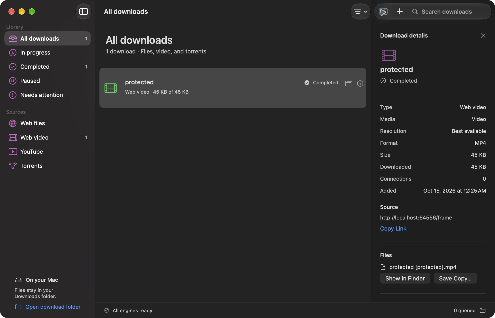

# Fetch for macOS

**Paste a link. Choose what to save. Fetch brings it to your Mac.**

Fetch is a download helper for Apple Silicon Macs. It saves website files, YouTube videos or audio, and torrents in one place. Think of it as a small delivery desk: add your links, watch each delivery, and pause or continue when you need to.

Built with SwiftUI and AppKit, Fetch feels at home on macOS. Its appearance follows your Mac's light or dark mode and chosen accent color.


## What you can do

- **Save files:** paste an HTTP or HTTPS link. Fetch can download large files in several pieces when the website supports it.
- **Save web videos:** use Find Video on supported websites, or Open Player to detect exposed video links and HLS/DASH streams. YouTube is supported too.
- **Download torrents:** paste a magnet or torrent link, or open a `.torrent` file.
- **Stay in control:** pause, resume, cancel or retry downloads. Search your list, filter it, and set a speed limit.
- **Find your files:** show finished downloads in Finder or save a copy somewhere else. Removing a history entry keeps the downloaded file.

Video formats: **MP4, WebM, MKV, MOV and Original**. Choose your default in Settings; each download can use a different format. Original keeps the source format and avoids extra conversion. Audio formats: **MP3, M4A, FLAC, WAV and Opus**. Available video quality depends on the source.

## Get started

Download **[Fetch-1.1.0-arm64.dmg](https://github.com/rakidoodle/fetch-macos/releases/download/v1.1.0/Fetch-1.1.0-arm64.dmg)** from the [GitHub release](https://github.com/rakidoodle/fetch-macos/releases/latest). Open it, drag Fetch into Applications, then open Fetch.

This repository also contains the app's source, artwork, screenshots and build tools. To make your own app, follow [Build from source](#build-from-source).

The tested app bundle needs **an Apple Silicon Mac running macOS 27 or later**. The Swift source targets macOS 14, but the engines used in the tested bundle require macOS 27. Supporting earlier systems requires compatible engine and library builds.

After building:

1. Open `release/Fetch.app`, or copy it into Applications first.
2. Press **Command-N** and paste a link. For YouTube, choose video or audio and your preferred format.
3. Use **Show in Finder** when the download finishes.

The finished bundle includes Node, aria2, yt-dlp, FFmpeg and ffprobe. It can run without Homebrew, Python, Node or the source folder installed separately. The release is ad-hoc signed and signature-checked; it does not have an Apple Developer ID signature or notarization. If macOS blocks the first launch and you trust this release, use **System Settings > Privacy & Security > Open Anyway**. See [Apple's instructions](https://support.apple.com/en-us/102445).

## Download a web video

1. Press **Command-N**, select **Web video**, and paste the page link.
2. Click **Find Video**. If the page needs its player, click **Open Player**, press Play, and choose **Use This Video** beside the detected stream.
3. Choose video or audio, select the output format, and click **Add Download**.

Embedded frames, direct media files, HLS (`.m3u8`) and DASH (`.mpd`) playlists can be detected. The app also detects video-element URLs without a file extension. Individual stream fragments are hidden from the candidate list. Pages can contain video ads, so choose the stream for your intended video. **Open Player Page** can open a detected iframe directly when its cookies require a first-party visit.

The private player starts with an empty browser profile. It does not import your usual browser's cookies. Cookies are scoped to the selected media host, held in memory, and passed to the engine through temporary private files. They are not written to Fetch history or service logs. Temporary cookie files are removed on transfer completion or service shutdown. After quitting, a captured player session must be refreshed by reopening the page; expired signed stream URLs are not saved in history.

Available quality depends on the source. The resolution menu offers caps when metadata lists resolutions; otherwise it uses source quality. Format conversion can take extra time. DRM-protected content and players that expose no usable stream remain unsupported. This app cannot promise downloads from every website.



## A few useful shortcuts

| Shortcut | Action |
| --- | --- |
| Command-N | Add a download |
| Command-F | Search downloads |
| Command-comma | Open settings |
| Option-Command-I | Show or hide file details |
| Option-Command-P | Pause the selected download |
| Option-Command-R | Resume or retry the selected download |
| Shift-Command-O | Open the download folder |

Settings control the number of simultaneous downloads, connections and speed limit. A speed limit of zero means unlimited. Connection changes apply to new transfers. The global speed limit affects file and torrent transfers immediately, and new YouTube transfers.

Closing the window keeps downloads running. **Command-Q** saves your history and pauses unfinished work. Reopen Fetch and resume those downloads when ready. Save Copy runs in the background, and quitting waits for active copies to finish.

<details>
<summary>See Fetch in light mode</summary>


Screenshots show the real app. The light-mode download is a controlled test file, with no personal download history.

</details>

## Your files and privacy

Downloaded files stay in `~/Downloads/Fetch/<transfer-id>/`. Settings and history live in `~/Library/Application Support/Fetch/state.json`. Service diagnostics live in that folder's `logs/service.log`.

Fetch uses a private local service on `127.0.0.1` with a random port and a fresh session token each time. API requests need that token, and writes also require a CSRF key. Host, origin and file-containment checks protect the service.

Downloads connect to their source websites, YouTube or torrent peers. BitTorrent can upload pieces while downloading; completed transfers do not keep seeding. This desktop app has its own storage and does not import the original web app's history automatically.

Local download history, credentials, build output, runtime data and raw logs are excluded from this repository. Test fixtures use disposable data.

## Build from source

Build on Apple Silicon with macOS Command Line Tools, Python 3, Node, aria2 and FFmpeg/ffprobe installed. Network access is needed to fetch the official yt-dlp release and license files. The Node dependency versions are pinned in `backend/package-lock.json`.

```bash
git clone https://github.com/rakidoodle/fetch-macos.git
cd fetch-macos
cd backend
npm ci --omit=dev --ignore-scripts
cd ..
python3 scripts/bundle.py
```

The scripts default to the stable SDK at `/Library/Developer/CommandLineTools/SDKs/MacOSX26.5.sdk`. Set `FETCH_BUILD_SDK` to a compatible installed SDK when needed. The build was verified with Command Line Tools; the tested preview macOS 27 SDK lacked the SwiftUI macro plugin.

The packager copies the engines, relocates their non-system libraries, verifies yt-dlp's official SHA-256 checksum, and signs and checks the app. It determines the bundle's minimum macOS version from the actual engine binaries. A prior successful build is kept as `release/Fetch.previous.app` during rebuilding.

To create a local disk image after packaging:

```bash
bash scripts/make-dmg.sh
```

Review the exact bundled components' license and corresponding-source requirements before redistributing a binary. See [third-party notices](THIRD_PARTY.md).

## Tested behavior

**32 automated tests passed: 12 Swift tests and 20 engine/API tests.** Packaged tests also downloaded extensionless media into all five video formats and checked authorization, CSRF and invalid requests. Additional checks exercised the real macOS interface, exact downloaded bytes, torrents, pause/resume, restart recovery and live YouTube video/audio downloads. Light and dark text contrast, bundle signatures and the installer were checked too.

See the [verification report](artifacts/VERIFICATION.md) for tested flows and limits. These results describe the tested build; websites, network conditions and future tool versions can change behavior.

Run the checks **after packaging finishes**:

```bash
bash scripts/test.sh
```

The script uses Swift Testing from Command Line Tools and supplies its framework and plugin paths. To include the live YouTube checks:

```bash
FETCH_LIVE_TESTS=1 bash scripts/test.sh
```

Live checks use Blender's public Big Buck Bunny video and inspect the output with the bundled ffprobe.

## Credits

Fetch builds on the download engine from [Fetch Download Manager](https://github.com/rakidoodle/fetch-download-manager). Native interface decisions are in [DESIGN.md](DESIGN.md).

The app icon and empty-library illustration were generated with the built-in ImageGen tool. [Generation prompts](Assets/generation-prompts.json) are included. The iconset, `.icns` and favicons derive from the generated master; regenerating those exports requires Python with Pillow. Interface glyphs use SF Symbols.

The original support link is preserved: [Feed my Baby](https://www.paypal.com/paypalme/ruffytrinidad).
